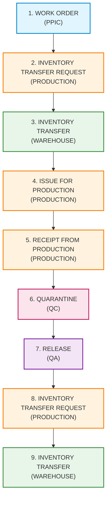

# Siklus Produksi End-to-End

Dokumen ini menjelaskan alur proses produksi secara menyeluruh (*end-to-end*), mulai dari penerbitan perintah kerja oleh **PPIC** hingga barang jadi berstatus *Released* masuk ke gudang utama (**Warehouse**).

---

## 1. Diagram Alur Proses (*Flowchart*)

### A. Diagram Visual (Mermaid)
*(Dapat dirender secara otomatis di GitHub, GitLab, Notion, Obsidian, dan VS Code)*



### B. Diagram Teks (ASCII)

```text
┌─────────────────────────────────────────────────────────────────────────┐
│                         1. WORK ORDER (PPIC)                            │
│              Penerbitan perintah kerja & kebutuhan BOM                  │
└────────────────────────────────────┬────────────────────────────────────┘
                                     ▼
┌─────────────────────────────────────────────────────────────────────────┐
│                2. INVENTORY TRANSFER REQUEST (PRODUCTION)               │
│         Permintaan transfer bahan baku dari gudang ke produksi          │
└────────────────────────────────────┬────────────────────────────────────┘
                                     ▼
┌─────────────────────────────────────────────────────────────────────────┐
│                   3. INVENTORY TRANSFER (WAREHOUSE)                     │
│          Pemindahan fisik & stok bahan baku ke area produksi            │
└────────────────────────────────────┬────────────────────────────────────┘
                                     ▼
┌─────────────────────────────────────────────────────────────────────────┐
│                   4. ISSUE FOR PRODUCTION (PRODUCTION)                  │
│         Pengeluaran/pemakaian bahan baku ke proses produksi (WIP)       │
└────────────────────────────────────┬────────────────────────────────────┘
                                     ▼
┌─────────────────────────────────────────────────────────────────────────┐
│                 5. RECEIPT FROM PRODUCTION (PRODUCTION)                 │
│        Pencatatan hasil barang jadi masuk ke lokasi karantina           │
└────────────────────────────────────┬────────────────────────────────────┘
                                     ▼
┌─────────────────────────────────────────────────────────────────────────┐
│                           6. QUARANTINE (QC)                            │
│        Inspeksi & pengujian kualitas produk selama status karantina     │
└────────────────────────────────────┬────────────────────────────────────┘
                                     ▼
┌─────────────────────────────────────────────────────────────────────────┐
│                            7. RELEASE (QA)                              │
│          Verifikasi batch record & persetujuan kelayakan produk         │
└────────────────────────────────────┬────────────────────────────────────┘
                                     ▼
┌─────────────────────────────────────────────────────────────────────────┐
│                8. INVENTORY TRANSFER REQUEST (PRODUCTION)               │
│        Permintaan transfer barang jadi (Released) ke gudang utama       │
└────────────────────────────────────┬────────────────────────────────────┘
                                     ▼
┌─────────────────────────────────────────────────────────────────────────┐
│                   9. INVENTORY TRANSFER (WAREHOUSE)                     │
│     Pemindahan barang jadi ke Finished Goods Warehouse (siap kirim)     │
└─────────────────────────────────────────────────────────────────────────┘
```

---

## 2. Rincian Tahapan & Tanggung Jawab (PIC)

| No | Dokumen / Tahapan | Departemen (PIC) | Deskripsi Aktivitas | Dampak Pergerakan Stok / Status |
| :-: | :--- | :--- | :--- | :--- |
| **1** | **Work Order** | **PPIC** | Menerbitkan jadwal, target kuantitas produksi, serta daftar kebutuhan material (*Bill of Materials* / BOM). | Dokumen perencanaan aktif (belum memotong stok fisik). |
| **2** | **Inventory Transfer Request** | **Production** | Mengajukan permintaan penarikan bahan baku (*Raw Material* & *Packaging*) dari gudang utama ke area produksi sesuai BOM. | Permintaan reservasi/alokasi stok dari *Raw Material Warehouse*. |
| **3** | **Inventory Transfer** | **Warehouse** | Menyiapkan (*picking*) dan menyerahkan fisik bahan baku ke bagian produksi. | Stok berpindah dari *Raw Material Warehouse* ke *Production Warehouse*. |
| **4** | **Issue for Production** | **Production** | Mencatat pemakaian aktual bahan baku ke dalam proses manufaktur. | Stok *Raw Material* di produksi berkurang; nilai berubah menjadi *Work in Process* (WIP). |
| **5** | **Receipt from Production** | **Production** | Melaporkan hasil produk jadi yang telah selesai diproduksi dari *Work Order* terkait. | Stok *Finished Goods* bertambah di lokasi/gudang *Quarantine*. |
| **6** | **Quarantine** | **QC** | Menahan barang agar tidak keluar/dijual sementara tim QC mengambil sampel dan melakukan pengujian laboratorium/fisik. | Status stok terkunci (*On-Hold / Quarantine*). |
| **7** | **Release** | **QA** | Meninjau hasil uji QC serta kelengkapan *Batch Production Record* (BPR), lalu memberikan persetujuan kelayakan edar. | Status stok berubah dari *Quarantine* menjadi *Released* (siap edar). |
| **8** | **Inventory Transfer Request** | **Production** | Mengajukan permintaan pemindahan barang jadi yang sudah berstatus *Released* dari area karantina menuju gudang barang jadi. | Permintaan pemindahan stok *Released* ke *Finished Goods Warehouse*. |
| **9** | **Inventory Transfer** | **Warehouse** | Menerima fisik barang jadi dari produksi dan menyimpannya di gudang utama. | Stok berpindah ke *Finished Goods Warehouse* dan siap untuk pengiriman (*Delivery*). |

---

## 3. Titik Kontrol Kritis (*Control Points*)

1. **Fase Persiapan Material (Tahap 1–3):**
   - Kuantitas pada *Inventory Transfer Request* harus mengacu pada BOM di *Work Order* untuk mencegah kelebihan stok di lantai produksi maupun kekurangan material di tengah proses.
2. **Fase Eksekusi Produksi (Tahap 4–5):**
   - Selisih pemakaian bahan baku (seperti *scrap*, *reject* proses, atau kelebihan material) wajib dicatat dan direkonsiliasi sebelum dokumen *Work Order* ditutup.
3. **Fase Mutu & Serah Terima Akhir (Tahap 6–9):**
   - Sistem ERP/WMS sebaiknya mengunci perpindahan stok dari lokasi *Quarantine* sehingga **Warehouse** tidak dapat mengeksekusi *Inventory Transfer* akhir (Tahap 9) sebelum dokumen **Release** dari **QA** terbit secara resmi.