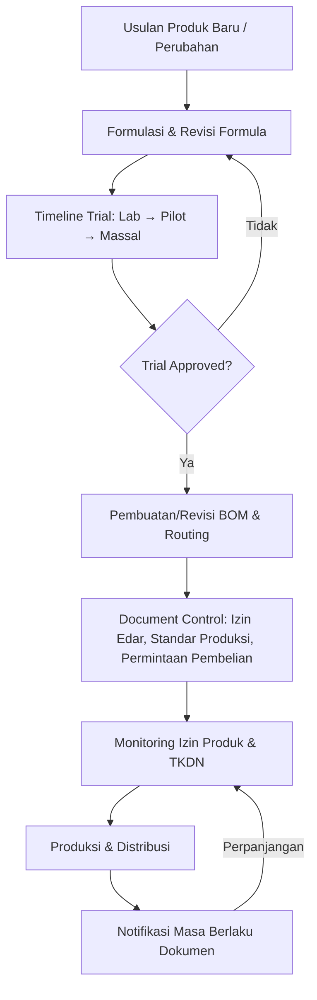

# Dokumen Penjabaran ERP — Modul SH-RD
## Product Lifecycle Management (PLM) & Document Control

| Metadata | Keterangan |
|---|---|
| **Kode Modul** | SH-RD |
| **Nama Modul** | Product Lifecycle Management (PLM) & Document Control |
| **Versi Dokumen** | 1.0 |
| **Tanggal** | 18 November 2026 |
| **Status** | Draf / Menunggu Persetujuan |
| **Disusun oleh** | Tim Implementasi ERP |
| **Disetujui oleh** | ______________________ |

---

## 1. Tujuan Dokumen
Dokumen ini merupakan penjabaran (breakdown) kebutuhan fungsional modul **SH-RD** dalam sistem ERP, yang mencakup pengelolaan siklus hidup produk mulai dari usulan produk baru, formulasi, trial, hingga pengelolaan dokumen izin edar, standar produksi, dan monitoring TKDN.

---

## 2. Ringkasan Cakupan Pekerjaan
Modul SH-RD mencakup:
1. **PLM** untuk usulan produk baru / usulan perubahan, formulasi, dan timeline trial.
2. **Integrasi** dengan BOM & Routing Produksi.
3. **Document Control** untuk dokumen izin edar, reformulasi, permintaan pembelian, dan standar produksi (bahan baku, bahan kemas, produk jadi, IPC produksi).
4. **Monitoring** pengajuan izin produk & TKDN.
5. **Notifikasi** masa berlaku dokumen dan perpanjangan izin.

---

## 3. Penjabaran Fitur

### 3.1 Usulan Produk Baru & Usulan Perubahan
| Aspek | Penjabaran |
|---|---|
| Fitur | Form pengajuan usulan produk baru / perubahan, approval workflow multi-level, riwayat revisi |
| Data utama | Nama produk, kategori, target pasar, estimasi biaya, justifikasi perubahan |
| Output | Nomor usulan, status (Draft → Submitted → Approved/Rejected) |

### 3.2 Formulasi
| Aspek | Penjabaran |
|---|---|
| Fitur | Penyusunan & revisi formula, versioning formula, kalkulasi komposisi (%) |
| Data utama | Daftar bahan, takaran, supplier bahan, catatan reformulasi |
| Kontrol | Akses terbatas (R&D), log perubahan (audit trail) |

### 3.3 Timeline Trial
| Aspek | Penjabaran |
|---|---|
| Fitur | Perencanaan jadwal trial (lab → pilot → massal), tracking hasil trial, sign-off tiap tahap |
| Data utama | Tahapan trial, tanggal mulai/selesai, hasil uji, PIC |
| Output | Status kelayakan produk sebelum masuk produksi |

### 3.4 Integrasi BOM & Routing Produksi
- Formula yang **approved** otomatis menjadi dasar pembuatan **BOM (Bill of Materials)**.
- Tahapan trial yang disetujui menjadi dasar **Routing** (urutan operasi produksi).
- Perubahan formula/reformulasi memicu **revisi BOM & Routing** dengan approval terstruktur.

### 3.5 Document Control
| Jenis Dokumen | Deskripsi |
|---|---|
| Dokumen izin edar | Registrasi & penyimpanan dokumen perizinan produk |
| Reformulasi | Dokumen pendukung perubahan formula |
| Permintaan pembelian | Dokumen permintaan pembelian bahan terkait produk baru |
| Standar produksi | Bahan baku, bahan kemas, produk jadi, IPC (In-Process Control) produksi |

Fitur: upload dokumen, klasifikasi, versioning, kontrol akses, status berlaku/tidak berlaku.

### 3.6 Monitoring Izin Produk & TKDN
- Dashboard status pengajuan izin produk (dalam proses / disetujui / ditolak).
- Pencatatan komponen & perhitungan **TKDN** (Tingkat Komponen Dalam Negeri) per produk.
- Tracking dokumen pendukung TKDN dari supplier.

### 3.7 Notifikasi Masa Berlaku Dokumen
- Peringatan otomatis (H-90/H-60/H-30) sebelum dokumen/izin kedaluwarsa.
- Alur pengajuan perpanjangan izin secara terstruktur.
- Kanal notifikasi: email, dashboard, dan pesan sistem.

---

## 4. Alur Proses Bisnis (High-Level)

---

## 5. Matriks Integrasi Antar Modul

| Modul Terkait | Titik Integrasi | Arah Data |
|---|---|---|
| PP (Produksi) | BOM & Routing dari formula approved | SH-RD → PP |
| MM (Material Management) | Permintaan pembelian bahan baku/kemas | SH-RD → MM |
| QM (Quality) | Standar produksi & IPC | SH-RD ↔ QM |
| SD (Sales & Distribution) | Status izin edar produk jadi | SH-RD → SD |
| FI/CO | Estimasi biaya produk | SH-RD → FI/CO |

---

## 6. Peran & Hak Akses

| Role | Akses |
|---|---|
| R&D Officer | Buat usulan, kelola formula & trial |
| R&D Manager | Approve usulan & formula |
| QA / Regulatory | Kelola dokumen izin edar & standar produksi |
| Procurement | Terima permintaan pembelian |
| Production Planner | Terima BOM & Routing |
| Admin Document Control | Kelola versioning & masa berlaku dokumen |
| Management | Dashboard monitoring & TKDN (read-only) |

---

## 7. Kebutuhan Fungsional & Non-Fungsional

**Fungsional:**
- WF-01: Approval workflow bertingkat untuk usulan produk.
- WF-02: Versioning formula, BOM, dan dokumen.
- WF-03: Dashboard monitoring izin & TKDN.
- WF-04: Notifikasi otomatis masa berlaku dokumen.

**Non-Fungsional:**
- Audit trail lengkap (siapa, kapan, perubahan apa).
- Kontrol akses berbasis role.
- Ketersediaan sistem ≥ 99,5%.
- Keamanan data (enkripsi, backup berkala).

---

## 8. Deliverables & Milestone

| Tahap | Deliverable | Target |
|---|---|---|
| 1 | Blueprint & konfigurasi PLM | Minggu ke-1–3 |
| 2 | Setup Document Control & workflow approval | Minggu ke-4–6 |
| 3 | Integrasi BOM, Routing, MM | Minggu ke-7–9 |
| 4 | Dashboard izin & TKDN + notifikasi | Minggu ke-10–11 |
| 5 | UAT & Go-Live | Minggu ke-12 |

---

## 9. Kriteria Penerimaan (UAT)
- [ ] Usulan produk baru dapat dibuat hingga disetujui end-to-end.
- [ ] Formula approved otomatis menghasilkan draft BOM & Routing.
- [ ] Dokumen izin edar & standar produksi dapat diunggah, divalidasi, dan diverifikasi versinya.
- [ ] Notifikasi perpanjangan dokumen terkirim otomatis sesuai jadwal.
- [ ] Dashboard TKDN menampilkan data akurat per produk.

---

## 10. Risiko & Mitigasi

| Risiko | Dampak | Mitigasi |
|---|---|---|
| Data formula lama tidak lengkap | Keterlambatan migrasi | Cleansing data sebelum go-live |
| Izin edar kedaluwarsa | Produk tidak bisa dijual | Notifikasi berjenjang H-90/60/30 |
| Resistensi user R&D | Adopsi rendah | Training & change management |

---

## 11. Glosarium
| Istilah | Definisi |
|---|---|
| PLM | Product Lifecycle Management |
| BOM | Bill of Materials — daftar bahan penyusun produk |
| Routing | Urutan operasi/proses produksi |
| IPC | In-Process Control — pengawasan selama proses produksi |
| TKDN | Tingkat Komponen Dalam Negeri |
| UAT | User Acceptance Test |

---

*Lampiran: screenshot cakupan pekerjaan modul SH-RD, form usulan produk, template dokumen standar produksi.*